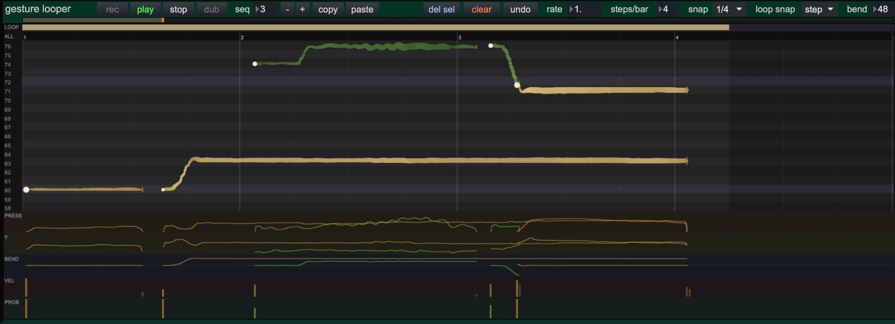
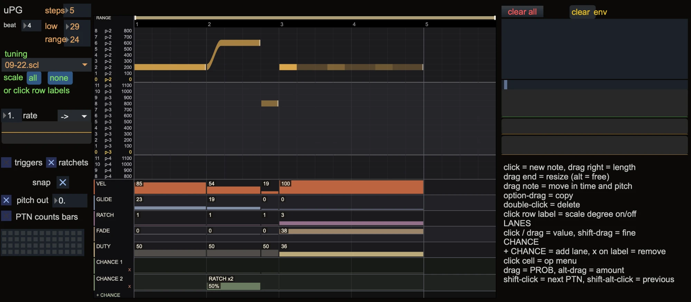

# dingus



*`dingus.gestureLooper`*



*`dingus.pitchGateSeq`*

dingus is a  Max package of bpatchers for integrating Max with modular synthesizer. It is very much tailored to my own needs and is hardly useful for anyone else, but I'm still sharing it in case anyone finds something handy there. The bpatchers are largely focused on scala files / microtonal tunings and controlled randomness. You need Max 9.

## Installation

1. Put the `dingus` folder in `~/Documents/Max 9/Packages/`.
2. Install the packages in [Dependencies](#dependencies).
3. Make a presets folder. Refer to [Presets folder](#presets-folder).
4. Start Max again.

## How to use bpatchers

Each file name starts with `dingus.`. Add a bpatcher to a patch with its file name:

    [bpatcher dingus.<name>.maxpat]

These bpatchers keep their own presets or sequences in a file:

- `dingus.gestureLooper`
- `dingus.pitchGateSeq`
- `dingus.pitchSeq`
- `dingus.gatesSeq`
- `dingus.voltagesModulator`

Give each instance of these bpatchers an instance name with the `@args` attribute:

    [bpatcher dingus.<name>.maxpat @args <instance name>]

The instance name sets the name of the presets file and of the pattrstorage. Use a different instance name for each instance of the same bpatcher. If two instances have the same name, they write to the same file.

The other bpatchers do not use `@args`. Their settings are stored in the studio patch.

## Presets folder

The scripts write all JSON files to one folder: presets, sequences and libraries. The scripts use the first of these folders that exists:

1. `~/Dropbox/_maxPresets/`
2. `~/Documents/Max 9/_maxPresets/`

Max cannot make folders. Make one of these folders before you use dingus. Then add the folder to the search path of Max (Options > File Preferences). If you do not do this, pattrstorage cannot find the presets when the patch opens.

The file name is `<prefix>_<instance name>.json`, for example `uPG_lead.json`. The script `javascript/dingus.paths.js` finds the folder. A v8 script loads it with `require("dingus.paths.js")`.

## Contents

### bpatchers (`patchers/`)

| bpatcher | Function | Presets file |
|---|---|---|
| `dingus.gestureLooper` | Records and plays MPE gestures. Put it between `midiin` and a note bpatcher. It has 32 sequences and a piano roll with lanes for pressure, Y, bend, velocity and probability. It has overdub, undo and a phasor clock. | `gestureLooper_<name>.json` |
| `dingus.pitchGateSeq` | A monophonic pitch and gate sequencer with a piano roll. The rows come from a Scala tuning. Each note has lanes for velocity, glide, ratchets, fade and duty. It has at least 3 chance lanes, with a cell editor, beats per step and a play range. Each sequence has its own swing. It has 32 sequences. A new sequence starts at the next phasor wrap. | `uPG_<name>.json`, sequences in `uPGseq_<name>.json` |
| `dingus.pitchSeq` | A step pitch sequencer for Scala tunings, on a gen~ engine. It has a pitch grid, a delay for each step, deleted steps, rest and skip probabilities and a tuning slider. It has 32 sequences. A new sequence starts at the next phasor wrap. The isRunning inlet takes a toggle: 0 stops, 1 starts from the first step. The first outlet is the pitch signal (0 to 1.0494); the second outlet sends the frequency as a message. | `uPITCH_<name>.json`, sequences in `uPITCHseq_<name>.json` |
| `dingus.gatesSeq` | A gate sequencer. A gate can span many steps. A lane sets the length of the last step of each gate. Ratchets can fade in or out. Each sequence has its own swing. It has 32 sequences. A new sequence starts at the next phasor wrap. | `uGATE_<name>.json`, sequences in `uGATEseq_<name>.json` |
| `dingus.voltagesModulator` | A stepped voltage modulator with rest and skip probabilities, on a gen~ engine. It has 32 sequences. A new sequence starts at the next phasor wrap. The isRunning inlet takes a toggle: 0 stops, 1 starts from the first step. | `uVOLT_<name>.json`, sequences in `uVOLTseq_<name>.json` |
| `dingus.masterClock` | The master phasor clock. It sends MIDI clock. Its clock modulation curve changes the tempo on purpose, for irregular clocks. | in the studio patch |
| `dingus.subClocker` | A sub-clock from the master phasor, with its own clock modulation curve. | in the studio patch |
| `dingus.lfoModulator` | An LFO that the phasor clock drives. It has resync and reset inputs. | in the studio patch |
| `dingus.msegModulator` | A multi-segment modulator that the phasor clock drives. | in the studio patch |
| `dingus.msegEnvelope` | A multi-segment envelope. A bang or a signal starts it. It has a duration input. | in the studio patch |
| `dingus.mainMixer` | The studio mixer: channel pairs 1+2 to 7+8, a sidechain and 3 FX returns. | in the studio patch |
| `dingus.pluginStereo` | A stereo plug-in host (`vst~`) with 3 parameter inputs (0 to 1). | in the studio patch |
| `dingus.plugin16in` | A stereo plug-in host with 16 parameter inputs (0 to 1). | in the studio patch |
| `dingus.pluginSideChain` | A stereo plug-in host with a stereo sidechain input (`mcs.vst~ 4 2`) and 3 parameter inputs. | in the studio patch |
| `dingus.pluginGRM` | A host for GRM Tools Atelier (VST3) with 16 parameter inputs (0 to 1). | in the studio patch |
| `dingus.pluginGRM32` | A host for GRM Tools Atelier (VST3) with 32 parameter inputs (0 to 1). | in the studio patch |
| `dingus.mpe2cv` | Changes MPE from `midiin` into control values (`mpeparse`). | in the studio patch |
| `dingus.gwonzer` | A controller for the Shnth, with 15 outlets. | in the studio patch |
| `dingus.es8Main` | The main I/O of the Expert Sleepers ES-8: 4 inputs and 4 outputs. | in the studio patch |
| `dingus.es8Outs` | 12 outputs to the ES-8 and its expanders (`dac~`). | in the studio patch |
| `dingus.es8UltraOuts` | 16 outputs to the ES-8 with the UltraLite-mk5 (`dac~`). | in the studio patch |
| `dingus.fighterTwister` | Bank 1 of the Midi Fighter Twister: 16 knobs with knob loopers and 32 outlets. | in the studio patch |
| `dingus.fighterTwister2` | Bank 2 of the Midi Fighter Twister. | in the studio patch |
| `dingus.fighterTwister3` | Bank 3 of the Midi Fighter Twister. | in the studio patch |
| `dingus.fighterTwister4` | Bank 4 of the Midi Fighter Twister. | in the studio patch |

### Scripts (`javascript/`)

| Script | Function |
|---|---|
| `dingus.paths.js` | Finds the presets folder (CommonJS module for v8). |
| `dingus.presetFile.js` | Reads and writes the presets file of one pattrstorage. |
| `dingus.studioPresets.js` | Reads and writes a presets file with the name of the studio patch: `[v8 dingus.studioPresets.js <fallback name>]`. |
| `dingus.gestureLoop.js` | The engine of `dingus.gestureLooper` (v8). |
| `dingus.gestureRoll.js` | The piano roll of `dingus.gestureLooper` (v8ui). |
| `dingus.gestureHead.js` | The position strip of `dingus.gestureLooper` (v8ui). |
| `dingus.pgRoll.js` | The piano roll of `dingus.pitchGateSeq` (v8ui). |
| `dingus.gateRoll.js` | The roll of `dingus.gatesSeq` (v8ui). |
| `dingus.envNext.js` | Sends "next" to a `function` envelope at gate-off, but only if the envelope has a sustain point. |
| `dingus.pitchGrid.js` | The pitch grid of `dingus.pitchSeq` (jsui). |
| `dingus.voltBank.js` | The 32 sequences of `dingus.voltagesModulator` and the tables of its gen~ engine (v8). |
| `dingus.pitchBank.js` | The 32 sequences of `dingus.pitchSeq` and the tables of its gen~ engine, with the pitch table from the tuning (v8). |
| `dingus.tuningSlider.js` | A key slider for Scala tunings in `dingus.pitchSeq`. This is `sslider.js` by Timo Hoogland. Refer to [Third-party notices](#third-party-notices). |

### Abstractions (`patchers/abstractions/`)

| Abstraction | Function |
|---|---|
| `dingus.clockThePam` | The clock output for Pamela's Workout. |
| `dingus.clockExternalMidiDevice` | The MIDI clock for an external device. |
| `dingus.es8InputsCompensation` | Compensation for the ES-8 inputs: 4 inputs, 1 output. |
| `dingus.es8OutsCalibration` | Calibration for 8 ES-8 outputs. |
| `dingus.twisterLooper` | The knob looper and the LED colours for bank 1 of the Midi Fighter Twister. `dingus.twisterLooperBank2` to `dingus.twisterLooperBank5` are for the other banks. |
| `dingus.updateKnobs` | Knob updates for the Midi Fighter Twister. All `dingus.fighterTwister` bpatchers use it. |

### Other folders

| Folder | Contents |
|---|---|
| `help/` | Help patches. Only `dingus.gestureLooper.maxhelp` is available at this time. |
| `code/` | gen~ code. |
| `extras/`, `snippets/` | Empty at this time. A browser for all bpatchers will go here. |
| `tests/` | Node tests for the scripts. |
| `docs/` | Specifications: `docs/gesture-looper.md`. |

## Dependencies

Install these packages before you use dingus. dingus does not include them.

| Package | Used by | Source |
|---|---|---|
| th.scala (Timo Hoogland, MIT License) | `dingus.pitchGateSeq`, `dingus.pitchSeq` | github.com/tmhglnd/th.scala |

## Tests

You need Node.js for the tests. Do the tests from the `dingus` folder:

    for t in tests/*.test.mjs; do node "$t"; done

## License

dingus is released under the MIT License (the `LICENSE` file). Some files contain third-party code. These files keep their own licenses. Refer to [Third-party notices](#third-party-notices).

The license text is in English, as written by its authors.

```
MIT License

Copyright (c) 2026 biomassa

Permission is hereby granted, free of charge, to any person obtaining a copy
of this software and associated documentation files (the "Software"), to deal
in the Software without restriction, including without limitation the rights
to use, copy, modify, merge, publish, distribute, sublicense, and/or sell
copies of the Software, and to permit persons to whom the Software is
furnished to do so, subject to the following conditions:

The above copyright notice and this permission notice shall be included in all
copies or substantial portions of the Software.

THE SOFTWARE IS PROVIDED "AS IS", WITHOUT WARRANTY OF ANY KIND, EXPRESS OR
IMPLIED, INCLUDING BUT NOT LIMITED TO THE WARRANTIES OF MERCHANTABILITY,
FITNESS FOR A PARTICULAR PURPOSE AND NONINFRINGEMENT. IN NO EVENT SHALL THE
AUTHORS OR COPYRIGHT HOLDERS BE LIABLE FOR ANY CLAIM, DAMAGES OR OTHER
LIABILITY, WHETHER IN AN ACTION OF CONTRACT, TORT OR OTHERWISE, ARISING FROM,
OUT OF OR IN CONNECTION WITH THE SOFTWARE OR THE USE OR OTHER DEALINGS IN THE
SOFTWARE.
```

## Third-party notices

dingus contains code from the projects below. The notices and license texts are as their authors wrote them.

### th.scala

`javascript/dingus.tuningSlider.js` is `sslider.js` by Timo Hoogland (2021). A part of `patchers/dingus.pitchSeq.maxpat` comes from th.scala. Both are under the MIT License of th.scala.

```
MIT License

Copyright (c) 2020 Timo Hoogland

Permission is hereby granted, free of charge, to any person obtaining a copy
of this software and associated documentation files (the "Software"), to deal
in the Software without restriction, including without limitation the rights
to use, copy, modify, merge, publish, distribute, sublicense, and/or sell
copies of the Software, and to permit persons to whom the Software is
furnished to do so, subject to the following conditions:

The above copyright notice and this permission notice shall be included in all
copies or substantial portions of the Software.

THE SOFTWARE IS PROVIDED "AS IS", WITHOUT WARRANTY OF ANY KIND, EXPRESS OR
IMPLIED, INCLUDING BUT NOT LIMITED TO THE WARRANTIES OF MERCHANTABILITY,
FITNESS FOR A PARTICULAR PURPOSE AND NONINFRINGEMENT. IN NO EVENT SHALL THE
AUTHORS OR COPYRIGHT HOLDERS BE LIABLE FOR ANY CLAIM, DAMAGES OR OTHER
LIABILITY, WHETHER IN AN ACTION OF CONTRACT, TORT OR OTHERWISE, ARISING FROM,
OUT OF OR IN CONNECTION WITH THE SOFTWARE OR THE USE OR OTHER DEALINGS IN THE
SOFTWARE.
```
